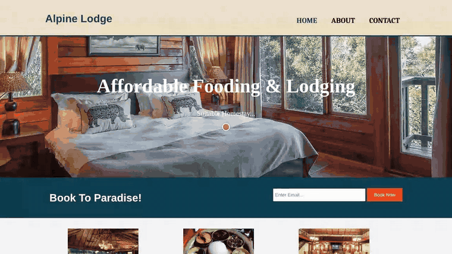

# Alpine Lodge

A website for Alpine Lodge, a small family-run lodge in Soreng, West Sikkim, India. Visitors can read about the lodge, send feedback, and book a room online. Booking creates an account, so guests can log in later to see their booking details. It is built with PHP and MySQL.



This demo was recorded from a local copy of the site (PHP 8.3 and MariaDB) with made-up guest details.

## Features

- **Home, About and Contact pages** with a shared header, navigation and footer, and a layout that adapts to small screens.
- **"Book Now" from any page:** a "Book To Paradise!" bar on every page takes an email address and opens the booking form with that email already filled in.
- **Online booking:** the booking form asks for an email address, username, password, phone number and country, then the check-in and check-out dates, number of rooms and guests (up to 6 each), meals (yes or no), a balcony, and any additional requirements. The browser checks the input formats (for example a 10-digit phone number and a username of letters only).
- **Booking details page:** after booking, the guest sees a summary of everything they entered.
- **Guest login:** a "My Profile" login box on the booking page. Logging in with the username and password shows the booking details again; a wrong password shows "Username or Password is invalid". There is also a log out button.
- **Feedback form:** the Contact page has a form (name, email, message) that sends the feedback as an HTML email with PHP's `mail()` function.

## How it works

1. `newsletter.php` (the "Book To Paradise!" bar) sends the email address to `booking.php` in the URL, and `booking.php` puts it into the email field.
2. Submitting the booking form posts to `act-register.php`, which saves the booking in the `booking` table of the `alpine` MySQL database and shows the booking details. The password is stored as an MD5 hash.
3. The login form posts to `act-login.php`, which looks up the username and hashed password. If they match, it shows that guest's booking details. If not, it stores an error message in the PHP session and sends the guest back to the login page (`booking1.php`), which shows the message.
4. `contact.php` handles its own feedback form and emails the message.

`booking.sql` is a phpMyAdmin export of the database. It creates the `booking` table, which holds both the guest's account (email, username, password hash, phone, country) and the booking (dates, rooms, guests, meals, balcony and requirements).

## Project structure

```
alpine(offline)/        The site, set up to run on a local server
├── index.php           Home page: showcase, "Stay", "Dine" and "Events" boxes
├── about.php           About the lodge
├── contact.php         Contact details and the feedback form
├── newsletter.php      "Book To Paradise!" email bar included on each page
├── booking.php         Booking form and login box (opened from "Book Now")
├── booking1.php        The same page, used after logging out or a failed login
├── act-register.php    Saves a new booking and shows its details
├── act-login.php       Logs a guest in and shows their booking details
├── footer.php          Shared footer
├── css/style.css       Styles, including the small-screen layout
└── img/                Photos
alpine(online)/         The same site, with the database settings of the old web host
booking.sql             Database export (the booking table)
ALPINE LODGE.pptx       Project presentation
acknowledgement.docx, certificate.docx   Parts of the project report
Project Description.txt Short description of the project
```

The two site folders are identical except for the database connection line at the top of `act-login.php` and `act-register.php`.

## Running it locally

You need PHP with the `mysqli` extension and a MySQL or MariaDB server. These steps were tested with PHP 8.3 and MariaDB 10.11.

1. Create the database and import the table:

   ```bash
   mysql -u root -e "CREATE DATABASE alpine"
   mysql -u root alpine < booking.sql
   ```

2. The `alpine(offline)` version connects to MySQL on `localhost` as `root` with an empty password (the default in XAMPP). If your MySQL user or password is different, change the connection line at the top of `act-login.php` and `act-register.php`.

3. Start PHP's built-in web server in the site folder and open http://localhost:8000/index.php:

   ```bash
   cd "alpine(offline)"
   php -S localhost:8000
   ```

You can also copy the `alpine(offline)` folder into XAMPP's `htdocs` folder and open it through Apache. The booking pages load Font Awesome and animate.css from CDNs, so the icons and the entrance animation need an internet connection. The feedback form only sends email on a server where PHP's `mail()` is set up.

## Built with

- **Frontend:** HTML5 and CSS3 (the page template comes from a Brad Traversy HTML5/CSS3 tutorial, which is why his name is in the pages' author meta tag), Font Awesome and animate.css
- **Backend:** PHP and MySQL (MariaDB)

This was our major project for the 6th semester of the Bachelor of Computer Applications (BCA) at Salesian College Sonada, India, built by Sangye Tenphel and Dipankar Roy over about three months in 2018. The site used to be online at alpinelodge.ga, but that deployment no longer exists.

Created by Sangye Tenphel, 2018.
